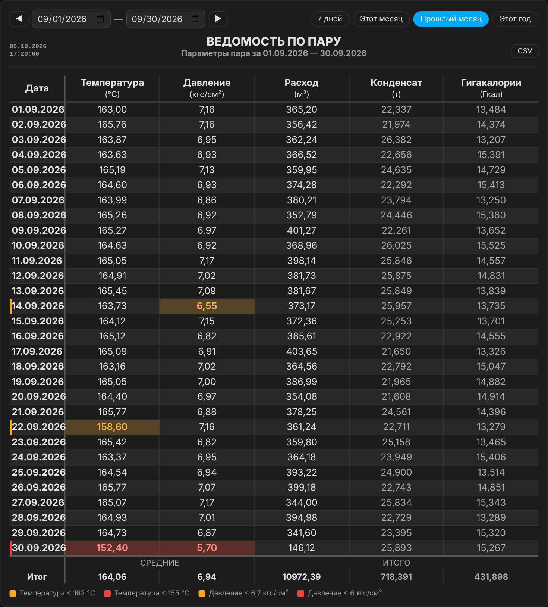
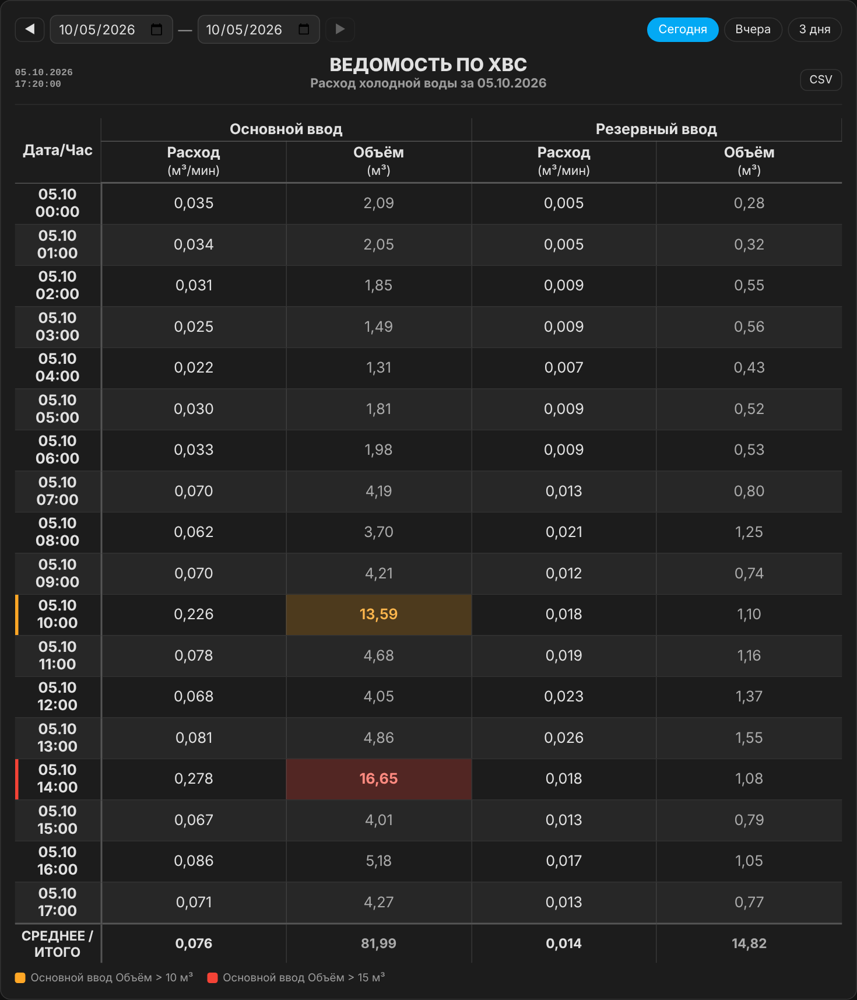

# Stats Table Card

[](https://hacs.xyz/)
[](https://github.com/Lordhmen/stats-table-card/releases)
[](https://github.com/Lordhmen/stats-table-card/actions/workflows/validate.yml)

Карточка Lovelace для Home Assistant, которая строит **табличные отчёты (ведомости)** по часам, суткам, неделям или месяцам из **долгосрочной статистики** HA. Подходит для учёта воды, пара, тепла, электроэнергии и любых других сенсоров со статистикой.

**[English version](README.en.md)**



## Зачем это нужно

Обычно такие таблицы собирают из SQL-запросов к базе recorder и выводят через markdown-карточку. У этого подхода есть проблемы:

- запрос за неделю выполняется десятки секунд, а за месяц может не уложиться совсем;
- история состояний очищается через `purge_keep_days` (по умолчанию 10 дней), поэтому старые данные пропадают;
- у markdown-карточки и атрибутов сенсоров есть ограничения по размеру;
- для каждой таблицы нужны своя автоматизация, сенсор-посредник и вспомогательные `input_datetime`.

**Stats Table Card** читает уже посчитанную статистику через websocket API (`recorder/statistics_during_period`):

- агрегацию делает сам HA, поэтому таблица за месяц или год строится за доли секунды;
- долгосрочная статистика хранится бессрочно, так что отчёт за любой прошлый месяц доступен всегда;
- не нужны SQL, автоматизации, шаблоны и вспомогательные сущности;
- выбор периода встроен прямо в карточку.

## Возможности

- Строки по **часам**, **суткам**, **неделям** или **месяцам**.
- Любые типы статистики: `mean`, `min`, `max`, `change`, `state`, `sum`.
- **Сборка из более мелкой статистики**: сутки из часов, часы из 5-минутных интервалов. Агрегаты: `sum`, `avg`, `avg_nonzero`, `min`, `max`, `first`, `last`, `count`.
  Например, энергию за сутки можно посчитать как сумму часовых средних мощностей.
- **Формулы** между столбцами (`c1 / 60`) и множитель для пересчёта единиц.
- **Группы столбцов** с двухуровневой шапкой.
- **Несколько строк итогов** (сумма, среднее, среднее без нулей, минимум, максимум) и **сводные строки** по дополнительным сенсорам за весь период.
- **Подсветка отклонений**: пороги `below` / `above` / `equals` / `empty`, уровни warn / bad / good, отметка строки, подсказки и легенда.
- **Выбор периода в карточке**: календарь, стрелки сдвига, быстрые периоды («Сегодня», «Этот месяц», «Прошлый месяц», …), запоминание выбора, ссылки `?from=&to=`.
- **Текущие сутки «вживую»**: строка за сегодня считается по 5-минутной статистике без часовой задержки, таблица обновляется по таймеру.
- **`prefer`** — точный источник (например, сенсор-накопитель) для завершённых интервалов с запасным расчётом для остальных.
- Экспорт в **CSV** для Excel: разделитель `;`, десятичная запятая, UTF-8 с BOM.
- **Печать**: панель выбора периода скрывается, цвета подсветки сохраняются.
- Тёмная и светлая темы через CSS-переменные HA.
- Без зависимостей: один JS-файл.



## Установка

### HACS (рекомендуется)

1. HACS → меню ⋮ → **Пользовательские репозитории**.
2. Репозиторий: `https://github.com/Lordhmen/stats-table-card`, тип: **Dashboard** (в старых версиях — *Lovelace*).
3. Найдите **Stats Table Card** и установите.
4. Обновите страницу браузера с очисткой кэша (Ctrl+F5).

### Вручную

1. Скачайте `stats-table-card.js` со страницы [релизов](https://github.com/Lordhmen/stats-table-card/releases).
2. Положите файл в `/config/www/stats-table-card.js`.
3. **Настройки → Панели → ⋮ → Ресурсы → Добавить ресурс**:
   - URL: `/local/stats-table-card.js?v=1.0.0`
   - Тип: **JavaScript-модуль**
4. Обновите страницу браузера с очисткой кэша.

> При обновлении файла вручную меняйте `?v=` в URL ресурса, чтобы браузеры не брали старую версию из кэша.

## Требования к сенсорам

Карточка работает только с сенсорами, по которым HA ведёт статистику, то есть с заданным `state_class`:

| `state_class` | Доступная статистика | Типичные сенсоры |
|---|---|---|
| `measurement` | `mean`, `min`, `max` | температура, давление, мощность, расход в моменте |
| `total`, `total_increasing` | `change`, `sum`, `state` | счётчики воды, энергии, газа, тепла |

Проверить, есть ли статистика у сенсора: **Инструменты разработчика → Статистика**.

Сколько хранятся данные:

- **часовая** (долгосрочная) статистика хранится бессрочно;
- **5-минутная** (краткосрочная) статистика хранится столько же, сколько история (`purge_keep_days`, по умолчанию 10 дней);
- **суточная, недельная и месячная** статистика вычисляется HA из часовой.

Поэтому столбцы с `source_period: 5minute` за давние даты будут пустыми, если не задан `fallback_stat` (см. ниже).

## Быстрый старт

```yaml
type: custom:stats-table-card
title: Расход воды
period: day
columns:
  - entity: sensor.water_meter_total
    name: Объём
    unit: м³
    stat: change
```

Получится таблица по суткам с выбором периода (по умолчанию «Этот месяц») и итоговой суммой.

## Параметры карточки

| Параметр | По умолчанию | Описание |
|---|---|---|
| `columns` | — | **Обязательный.** Список столбцов, см. [Параметры столбца](#параметры-столбца). |
| `period` | `day` | Шаг строк: `hour`, `day`, `week`, `month`. |
| `title` | — | Заголовок таблицы. |
| `subtitle` | `За {range}` | Подзаголовок; `{range}` заменяется на выбранный период. |
| `date_header` | `Дата` | Заголовок первого столбца. |
| `date_format` | `DD.MM.YYYY` | Для `period: day` можно задать `DD.MM`. |
| `decimal_separator` | `,` | Десятичный разделитель (`,` или `.`). |
| `empty` | `—` | Что показывать, если данных нет. |
| `font_size` | `.8em` | Размер шрифта таблицы, например `1.05em`. |
| `column_borders` | `true` | Вертикальные разделители между столбцами. |
| `show_footer` | `true` | Показывать строки итогов. |
| `footer_title` | `Итог` | Подпись строки итогов (когда нет `footers`). |
| `footer_labels` | `true` | Строка с подписями «СРЕДНИЕ / ИТОГО» над итогом (когда нет `footers`). |
| `footers` | — | Несколько строк итогов, см. [Итоги](#итоги). |
| `summary` | — | Сводные строки по другим сенсорам, см. [Сводные строки](#сводные-строки). |
| `live_today` | `true` | Строка за сегодня (для `period: day`) считается по 5-минутной статистике. |
| `refresh_interval` | `300` | Автообновление, секунды; `0` — выключить. |
| `csv` | `true` | Кнопка скачивания CSV. |
| `show_debug` | `false` | Показывать время загрузки и версию карточки. |
| `highlight_legend` | `true` | Легенда правил подсветки под таблицей. |
| `prefer_since` | — | Дата (`YYYY-MM-DD`) или время ISO, с которой действует `prefer` у столбцов. |
| `time_zone` | часовой пояс HA | Часовой пояс для границ суток. |

### Выбор периода

| Параметр | По умолчанию | Описание |
|---|---|---|
| `controls` | `true` | Панель выбора периода; `false` — скрыть. |
| `default_range` | `month` (для `hour` — `today`) | Период при первом открытии: имя быстрого периода. |
| `presets` | для `day`: `7d, month, prev_month, year`<br>для `hour`: `today, yesterday, 3d` | Кнопки быстрых периодов. |
| `storage_key` | путь страницы + заголовок | Ключ, под которым выбранный период запоминается в браузере. Задайте явно, если на странице несколько карточек с одинаковым заголовком. |
| `url_params` | `true` | Брать период из ссылки `?from=YYYY-MM-DD&to=YYYY-MM-DD`. |
| `start_entity`, `end_entity` | — | Совместимость со старыми настройками: брать период из двух `input_datetime`. |
| `range_mode` | — | `card` — игнорировать `start_entity`/`end_entity` и использовать встроенный выбор. |

Доступные быстрые периоды: `today`, `yesterday`, `3d`, `7d`, `30d`, `month` (с 1-го числа по сегодня), `prev_month`, `year`.

Особенности:

- Стрелки ◀ ▶ сдвигают период на его длину. Если выбран целый месяц, стрелки переключают календарные месяцы.
- Если выбран быстрый период, он «едет» вместе со временем: «Сегодня» после полуночи покажет новый день.
- Произвольные даты запоминаются как есть.

## Параметры столбца

| Параметр | По умолчанию | Описание |
|---|---|---|
| `entity` | — | Сенсор со статистикой. Обязателен, если нет `formula`. |
| `formula` | — | Вычисляемый столбец, см. [Формулы](#формулы). |
| `name` | id сенсора | Заголовок столбца. |
| `unit` | — | Единица измерения в шапке. |
| `group` | — | Название группы: соседние столбцы с одинаковой группой получают общую шапку. |
| `stat` | `mean` | Тип статистики: `mean`, `min`, `max`, `change`, `state`, `sum`. |
| `decimals` | `2` | Знаков после запятой. |
| `multiplier` | `1` | Множитель значения (пересчёт единиц). |
| `source_period` | — | Собрать значение из более мелкой статистики: `hour` или `5minute`. |
| `agg` | `avg` | Как сворачивать мелкие интервалы: `sum`, `avg`, `avg_nonzero`, `min`, `max`, `first`, `last`, `count`. |
| `fallback_stat` | — | Если мелкой статистики нет (например, 5-минутная уже очищена), взять этот тип статистики того же периода. |
| `prefer` | — | Точный источник для завершённых интервалов, см. [prefer](#prefer--точный-источник). |
| `footer` | `sum` для `change` и `agg: sum`, иначе `avg` | Итог столбца: `sum`, `avg`, `avg_nonzero`, `min`, `max`, `count`, `first`, `last`, `none`. |
| `footer_decimals` | как `decimals` | Знаков после запятой в итоге. |
| `footer_label` | по типу итога | Своя подпись в строке «СРЕДНИЕ / ИТОГО». |
| `dim` | `false` | Приглушённый цвет (второстепенный столбец). |
| `highlight` | — | Правила подсветки, см. [Подсветка](#подсветка-отклонений). |

### Как считается значение ячейки

1. **Без `source_period`.** Берётся статистика того же периода, что и таблица. Для суточной таблицы со `stat: change` это расход за сутки, со `stat: mean` — среднее за сутки.
2. **С `source_period`.** Берутся все мелкие интервалы внутри строки и сворачиваются через `agg`. Например:
   - `source_period: hour`, `stat: mean`, `agg: sum` — сумма часовых средних (кВт → кВт·ч за сутки);
   - `source_period: hour`, `stat: change`, `agg: avg_nonzero` — средний часовой расход только по часам, когда расход был;
   - `source_period: 5minute`, `stat: mean`, `agg: last` — значение на конец часа.
3. **`multiplier`** применяется к результату.
4. **`prefer`** при наличии заменяет значение для завершённых интервалов.
5. **`formula`** вычисляется последней, по уже готовым значениям строки.

`avg_nonzero` возвращает среднее только по ненулевым значениям. Если данные есть, но все нулевые, результат `0`. Если данных нет совсем — прочерк.

### Формулы

Столбцы нумеруются с нуля по порядку в `columns`: `c0`, `c1`, `c2`, … Формула может ссылаться на любые столбцы, кроме формул, стоящих правее. Допустимы числа, `+ - * / ( )`.

```yaml
columns:
  - name: Расход
    unit: м³/мин
    formula: c1 / 60
    decimals: 3
  - entity: sensor.water_meter_total
    name: Объём
    unit: м³
    stat: change
```

Если любое значение в формуле пустое, результат тоже пустой.

## Итоги

Без `footers` под таблицей одна строка `footer_title`, где у каждого столбца своя агрегация `footer`. Над ней подписи «СРЕДНИЕ / ИТОГО» (отключаются через `footer_labels: false`).

С `footers` можно вывести несколько строк, каждая со своей агрегацией для всех столбцов:

```yaml
footers:
  - title: СРЕДНЕЕ
    unit: (кВт)
    agg: avg_nonzero
    dim: true
  - title: ИТОГО
    unit: (кВт·ч)
    agg: sum
    decimals: 0
```

| Поле | Описание |
|---|---|
| `title` | Подпись строки. |
| `unit` | Подпись под заголовком (мелким шрифтом). |
| `agg` | Агрегация для всех столбцов; если не задана — `footer` каждого столбца. |
| `decimals` | Знаков после запятой; иначе `footer_decimals` / `decimals` столбца. |
| `dim` | Приглушённый цвет строки. |

## Сводные строки

Строки под итогами со значениями других сенсоров за весь период. Значение считается по часовой статистике.

```yaml
summary:
  - label: ГН / ВН
    cells:
      - prefix: "ГН: "
        entity: sensor.ratio_gn
        stat: mean
        decimals: 1
        suffix: "%"
        span: 3
        gend: true
      - prefix: "ВН: "
        entity: sensor.ratio_vn
        suffix: "%"
        span: 4
```

| Поле | По умолчанию | Описание |
|---|---|---|
| `entity` | — | Сенсор (без него ячейка содержит только текст). |
| `stat` | `mean` | Тип часовой статистики. |
| `agg` | `avg` | Как свернуть часы периода. |
| `decimals` | `1` | Знаков после запятой. |
| `prefix`, `suffix` | — | Текст до и после значения. |
| `span` | `1` | Сколько столбцов занимает ячейка. |
| `gend` | `false` | Разделитель справа (как между группами). |

## Подсветка отклонений

```yaml
columns:
  - entity: sensor.steam_temperature
    name: Температура
    unit: °C
    highlight:
      - below: 162
        level: warn
        row: true
      - below: 155
        level: bad
        row: true
```

| Поле | Описание |
|---|---|
| `below` | Значение меньше порога. |
| `above` | Значение больше порога. |
| `equals` | Значение равно числу. |
| `empty` | `true` — подсветить ячейку без данных. |
| `level` | `warn` (оранжевый, по умолчанию), `bad` (красный), `good` (зелёный). |
| `row` | Пометить всю строку цветной полосой у даты. |
| `label` | Свой текст подсказки и легенды. |

Условия внутри одного правила объединяются через «и»: `{above: 5, below: 10}` означает диапазон от 5 до 10. Если подходит несколько правил, выбирается самое тяжёлое (bad > warn > good). Наведите курсор на ячейку, чтобы увидеть сработавшее правило.

## prefer — точный источник

Иногда есть более точный источник, но он появился недавно или бывает только для завершённых интервалов. Типичный пример: накопительный счётчик энергии вместо расчёта по мощности. `prefer` подставляет его значение там, где оно есть и интервал уже закончился:

```yaml
prefer_since: "2026-10-06"
columns:
  - entity: sensor.power_kw
    name: Энергия
    unit: кВт·ч
    source_period: hour
    stat: mean
    agg: sum
    prefer:
      entity: sensor.energy_kwh_total
      stat: change
```

- Для интервалов, начавшихся раньше `prefer_since` (или `prefer.since`), и для текущего незавершённого интервала используется основной расчёт.
- Поля `prefer`: `entity`, `stat` (по умолчанию `change`), `source_period`, `agg`, `since`, `multiplier` (по умолчанию как у столбца).

## Рецепты

Готовые конфигурации — в папке [`examples/`](examples/).

### Энергия по мощности

Если счётчик отдаёт только мощность (кВт), энергию за сутки можно посчитать как сумму часовых средних:

```yaml
- entity: sensor.power_kw
  name: Энергия
  unit: кВт·ч
  source_period: hour
  stat: mean
  agg: sum
  decimals: 0
- entity: sensor.power_kw
  name: Ср. мощность
  unit: кВт
  source_period: hour
  stat: mean
  agg: avg_nonzero
  decimals: 0
  dim: true
```

Ещё точнее — создать помощник **«Интеграл (сумма Римана)»** по сенсору мощности. Он даст накопительный сенсор кВт·ч, который можно использовать со `stat: change` напрямую или через `prefer`.

### Часовая таблица со значением на конец часа

```yaml
- entity: sensor.power_kw
  source_period: 5minute
  stat: mean
  agg: last
  fallback_stat: mean
```

Пока 5-минутная статистика хранится, берётся последний 5-минутный интервал часа. Для более старых дат — среднее за час.

### Отчёт по месяцам за год

```yaml
type: custom:stats-table-card
title: Потребление по месяцам
period: month
default_range: year
presets: [year]
columns:
  - entity: sensor.water_meter_total
    stat: change
    name: Объём
    unit: м³
```

### Ссылка на конкретный период

```
https://ваш-ha/lovelace/reports?from=2026-09-01&to=2026-09-30
```

## Печать и экспорт

- Кнопка **CSV** скачивает таблицу с итогами и сводными строками. Файл сразу открывается в Excel с правильной кодировкой и десятичной запятой.
- При печати страницы (Ctrl+P) панель выбора периода и кнопки скрываются, подсветка сохраняется. Для кнопки печати на дашборде можно использовать, например, `button-card` с `window.print()`.

## Ограничения

- Работает только со статистикой recorder: сенсоры без `state_class` не поддерживаются.
- 5-минутная статистика доступна лишь за последние `purge_keep_days` дней; используйте `fallback_stat`.
- Часовая статистика HA появляется с задержкой (после окончания часа + несколько минут). Для текущих суток карточка использует 5-минутную статистику (`live_today`).
- Если у сенсора было изменение масштаба или сброс без правильного `state_class`, в статистике появится скачок. Исправить его можно в **Инструменты разработчика → Статистика → корректировка суммы**.
- Интерфейс карточки на русском языке. Подписи таблицы настраиваются (`title`, `subtitle`, `date_header`, `footer_title`, `name`…).
- Визуального редактора нет, настройка через YAML.

## Разработка

```bash
node --check stats-table-card.js   # проверка синтаксиса
node --test tests/*.test.mjs       # тесты (Node.js 18+)
python3 -m http.server             # затем открыть /docs/demo.html — демо без Home Assistant
```

Ошибки и пожелания — в [Issues](https://github.com/Lordhmen/stats-table-card/issues).

## Лицензия

[MIT](LICENSE)
